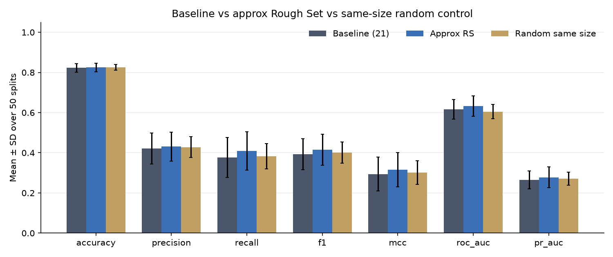

# Rough Set Feature Reduction for Software Defect Prediction

**Can rough set theory remove software metrics without hurting defect prediction?**
A leakage-safe study on the NASA KC1 dataset, with exhaustive reduct search, random-subset controls and paired significance tests.

Course project, *Granular Computing*, Sichuan University (2026).
Team: Achraf Ait Tayeb, Maryam Mafoud, Ouassim Lahraoui.



---

## Summary

- A **strict rough set reduct** drops about **19%** of the 21 metrics (16.9 kept on average) with **no measurable change** in prediction (all paired Wilcoxon p > 0.5).
- An **approximate reduct** (α = 0.90) drops about **41%** (12.3 kept) and is slightly better than the full baseline on F1 (+0.023, p = 0.036) and ROC-AUC (+0.015, p = 0.032).
- **Same-size random subsets do about as well as the strict reduct.** So the honest conclusion is that rough sets compress the metric set well, not that they pick better features than chance. The approximate reduct beats random subsets on ROC-AUC only (p < 0.001).
- An **exhaustive search over all 2²¹ = 2,097,152 subsets** shows there are exactly two minimum strict reducts (17 features each), and the QuickReduct heuristic found one of them.

## Research question

KC1 describes 2,109 software modules with 21 static code metrics (lines of code, McCabe and Halstead measures). Many of these metrics are strongly related. We ask:

1. How many metrics can a rough set reduct remove while keeping the dependency of the defect label on the metrics?
2. Does a model trained on the reduced set predict defects as well as one trained on all 21?
3. Is any benefit due to rough set selection itself, or would removing the same number of random metrics do just as well?

## Method

| Step | Choice |
|---|---|
| Data | PROMISE / NASA KC1, 2,109 modules, 21 metrics, 326 defective (15.5%). No missing values. Duplicate rows and conflicting labels are kept and reported, not removed. |
| Granulation | 3-bin equal-frequency discretization (Low / Medium / High). 5-bin, 8-bin and MDLP as sensitivity checks. |
| Feature selection | Dependency-based QuickReduct with backward pruning. **Strict** reduct keeps full dependency γ; **approximate** reduct keeps ≥ 90% of it. |
| Evaluation | Repeated stratified 10-fold cross-validation, 5 repeats (50 test folds), seed 42. |
| Classifier | `DecisionTreeClassifier(random_state=42)`, no resampling, no class weights, no tuning, so differences come from the features only. |
| Controls | For every fold, 10 random subsets of the same size as the rough set subset. |
| Statistics | Paired Wilcoxon signed-rank tests over the same 50 folds. |

**No test-data leakage.** Inside every fold, discretization bins and reducts are fitted on the training part only. The selected metric names are then applied to the original numeric data, and the model is scored on the untouched test fold. The full-dataset exhaustive search is descriptive and never feeds into a test fold.

## Results

Mean over 50 test folds (positive class = defective).

| Feature set | Features | F1 | MCC | ROC-AUC | PR-AUC |
|---|---|---|---|---|---|
| Baseline | 21 | 0.393 | 0.294 | 0.617 | 0.266 |
| Strict reduct | 16.9 | 0.396 | 0.296 | 0.619 | 0.268 |
| Random, strict size | 16.9 | 0.399 | 0.300 | 0.615 | 0.269 |
| Approximate reduct (α = 0.9) | 12.3 | **0.416** | **0.316** | **0.632** | **0.278** |
| Random, approximate size | 12.3 | 0.401 | 0.302 | 0.605 | 0.271 |

Full table with standard deviations, accuracy, precision and recall: [`results/final_summary.txt`](results/final_summary.txt). All significance tests: [`results/statistical_tests.csv`](results/statistical_tests.csv).

**Full-dataset rough set analysis (3 bins):** dependency γ = 0.322 (680 of 2,109 modules in the positive region), 408 granules. The two minimum reducts differ only by Halstead effort `e` versus time `t`, which are almost the same quantity (t = e / 18). Their 16-feature intersection is the core of this decision table.

## Limitations

- One dataset, one classifier. Results may differ on other PROMISE datasets or with other models.
- The defect class is small (15.5%), so absolute F1 and PR-AUC are low for every feature set.
- Equal-frequency binning is a modelling choice; the sensitivity runs in `results/discretization_sensitivity_*.csv` show how results move with it.
- No correction for multiple comparisons; the approximate-reduct p-values near 0.03 should be read as suggestive.

## Validation

47 automated tests cover the rough set calculations, discretization, strict and approximate reduct guarantees, exhaustive-search correctness, train/test separation, leakage checks and output validity. The main run also checks itself and records the result at the top of `results/final_summary.txt` (for example, no train/test overlap in any fold).

## Run it

```bash
python3 -m venv .venv
source .venv/bin/activate        # Windows: .venv\Scripts\activate
pip install -r requirements.txt

python -m pytest                                  # 47 tests, a few seconds
python src/run_final_unified_experiment.py        # full study, about 5 minutes
```

Results are written to `results/final/`. Add `--skip-exhaustive` to skip the 2²¹ subset search.

## Repository layout

```
src/rough_sets.py                     rough set core: decision table, dependency, QuickReduct, exhaustive search
src/discretization.py                 equal-frequency and MDLP binning
src/unified_protocol.py               the leakage-safe per-fold pipeline
src/run_final_unified_experiment.py   the main experiment
src/audit_kc1.py                      dataset audit (duplicates, conflicting labels)
tests/                                pytest suite
results/                              outputs from the reported run, with plots in results/plots/
data/raw/kc1.csv                      the dataset
```

## Dataset

NASA Metrics Data Program, KC1, as distributed in the PROMISE Software Engineering Repository (Sayyad Shirabad, J. and Menzies, T. J., 2005, School of Information Technology and Engineering, University of Ottawa).
